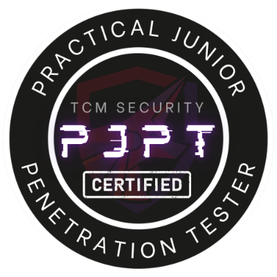
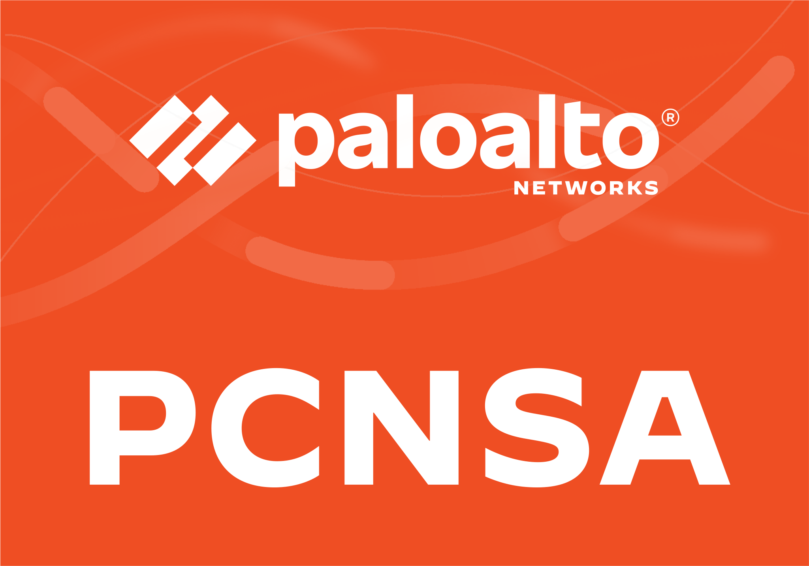

# /home/ptikek

```bash
ptikek@Mac:~$ whoami
ptikek # Yassine AHDDAK
ptikek@Mac:~$ pwd
/home/ptikek
ptikek@Mac:~$ ls -la
-rw-rw-r--  1 ptikek ptikek   104 Nov 29 12:00 My Certifications
-rw-rw-r--  1 ptikek ptikek   104 Nov 29 12:00 My hobbies
-rw-rw-r--  1 ptikek ptikek   104 Nov 29 12:00 Platforms profiles
-rwxrwxr-x  1 ptikek ptikek  1230 Nov 19 12:00 CV_Yassine_AHDDAK.pdf

```

## My Certifications

<div align="left"><figure><figcaption><p>Practical Junior Penetration Tester</p></figcaption></figure></div>

<div align="left"><figure><figcaption><p>Palo Alto Networks Certified<br>Network Security Administrator</p></figcaption></figure></div>

<div align="left"><figure><figcaption><p>SentinelOne Security<br>Administrator</p></figcaption></figure> <figure><figcaption><p>SentinelOne Incident<br>Responder</p></figcaption></figure> <figure><figcaption><p>SentinelOne Sales Engineer<br>Expert</p></figcaption></figure> <figure><figcaption><p>SentinelOne Sales Engineer<br>Professional</p></figcaption></figure> <figure><figcaption><p>SentinelOne Sales<br>Professional</p></figcaption></figure></div>

**Credly profile :** [https://www.credly.com/users/yassine-ahddak/badges/credly](https://www.credly.com/users/yassine-ahddak/badges/credly)


## My hobbies

* CTFs (Capture The Flags)
  * Affiliate link Creed-CTF : [https://creed-ctf.fr/auth/register?ref=XIP0L6KDLI3W](https://creed-ctf.fr/auth/register?ref=XIP0L6KDLI3W)
* Calisthenics
* Books


## Platforms profiles

* Creed-CTF : [https://creed-ctf.fr/u/ptikek](https://creed-ctf.fr/u/ptikek)
* HackTheBox : [https://profile.hackthebox.com/profile/01a12d01-a667-7207-9ca8-ded69e106722](https://profile.hackthebox.com/profile/01a12d01-a667-7207-9ca8-ded69e106722)
* PwnedLabs : [https://app.pwnedlabs.io/@ptikek](https://app.pwnedlabs.io/@ptikek)


## My CV ⇒ updated Nov 25 2026



**SHA-256 :** 205644fc163c43cdda913838bcf97e0fad3de9cf914a0c9ec6ab67ee5369d937
